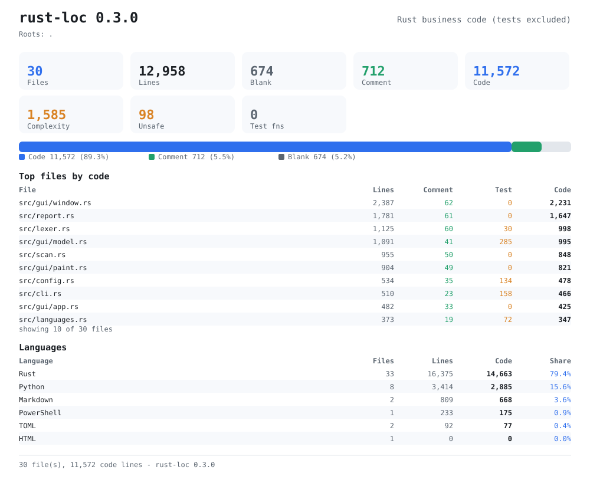
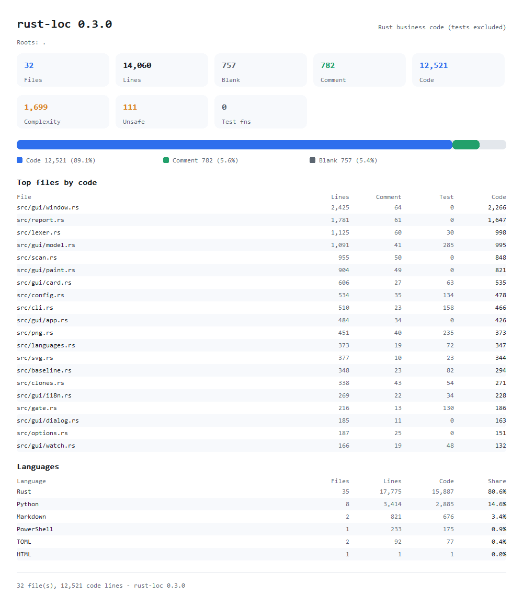
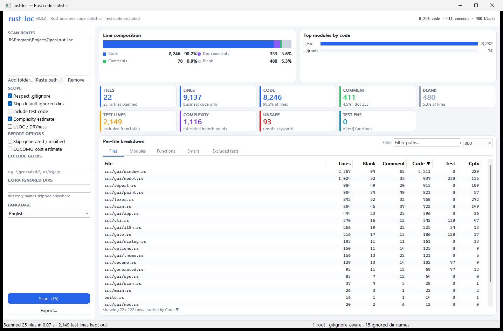
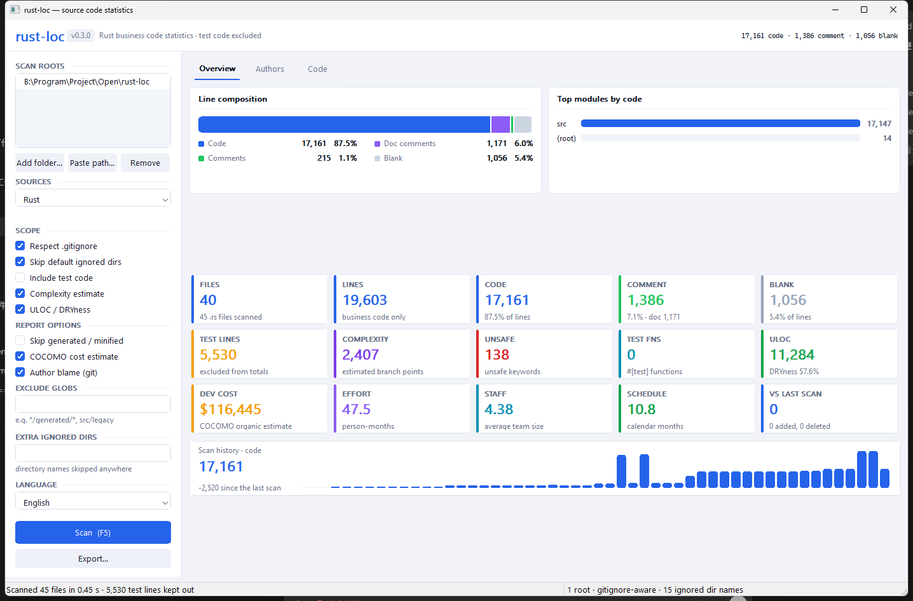
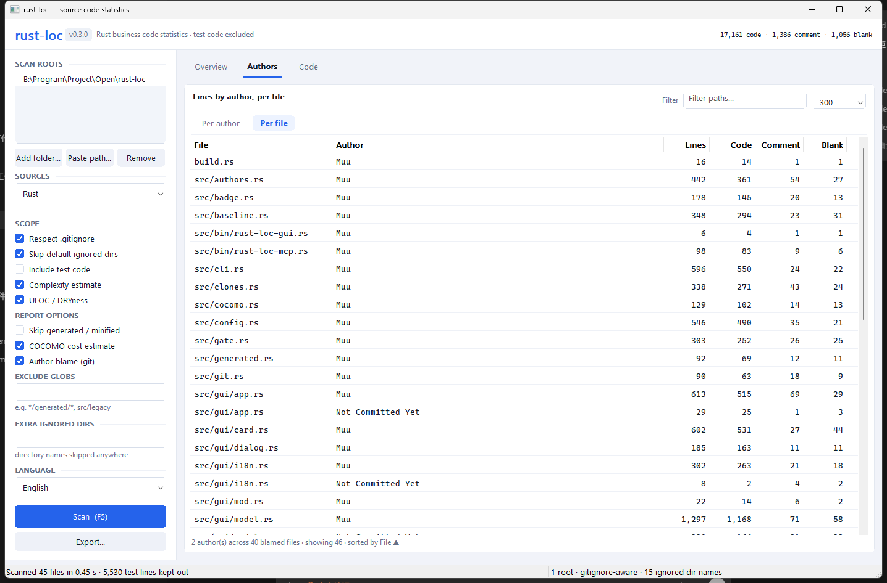
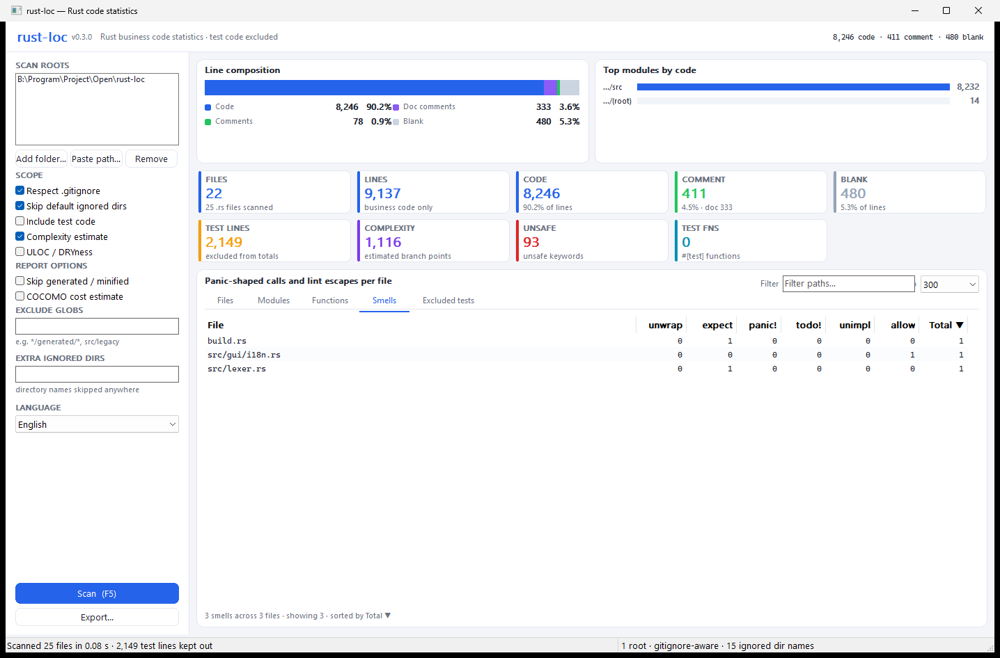
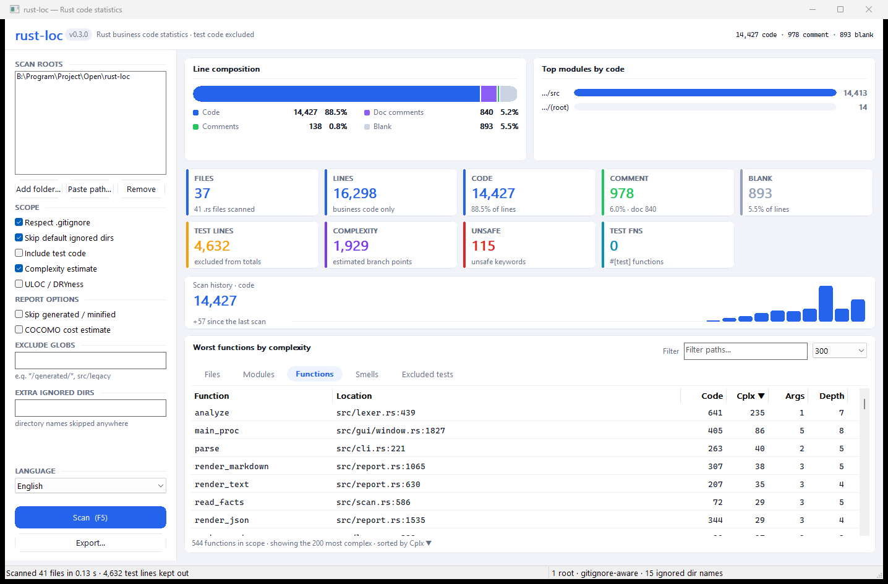
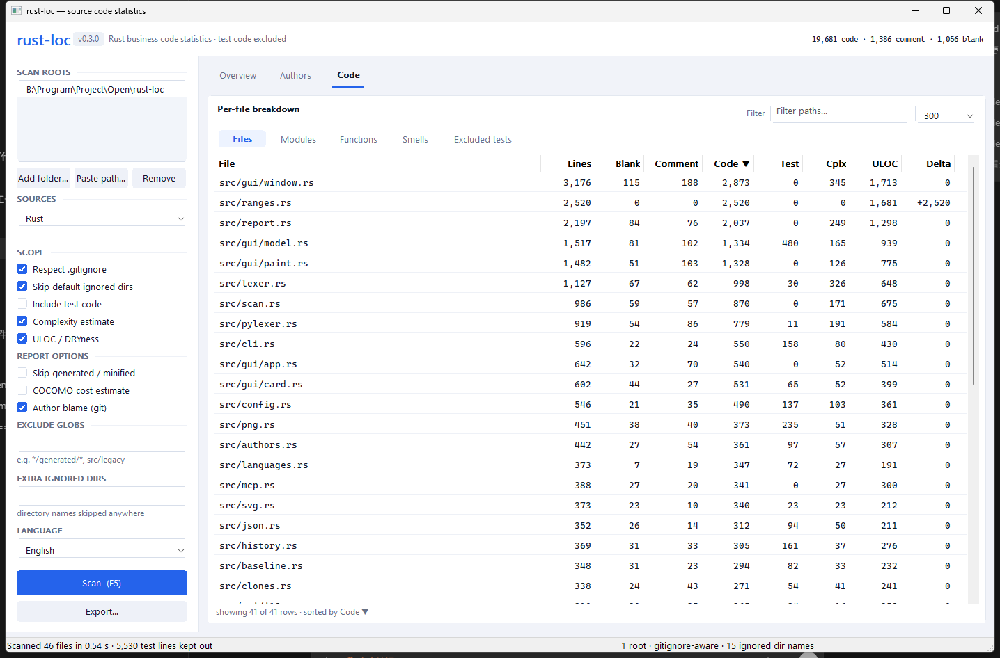
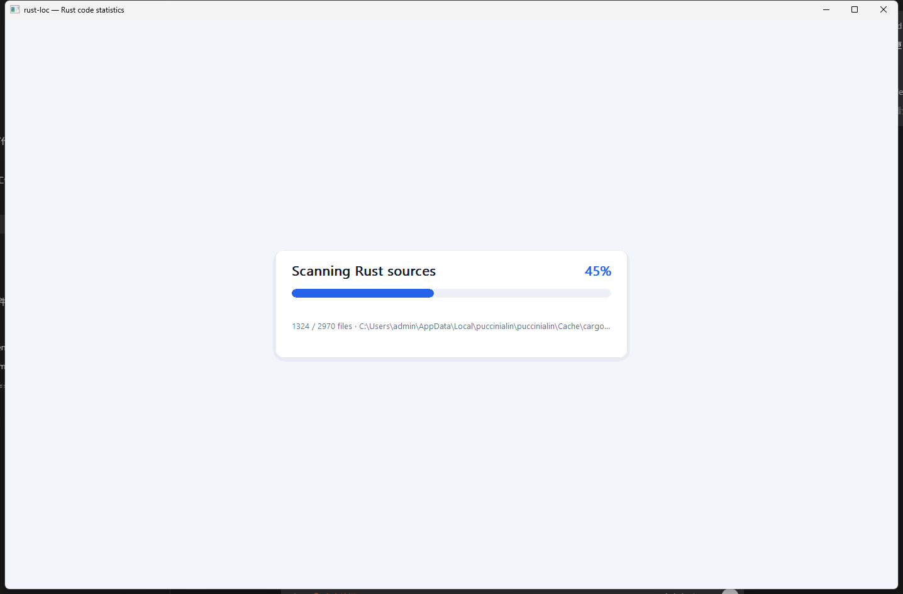

# rust-loc

Count source lines with **test code excluded** — Rust by default, Python too
with `--sources` — plus the metrics the other counters skip: ULOC/DRYness, an
scc-compatible complexity estimate, `unsafe` use and test-function totals.

`rust-loc` is a single-binary Rust tool. `python/` holds the original Python
implementation the Rust port was matched against line for line, and
`scripts/check-parity.ps1` re-runs that comparison on a tree both CLIs
understand. The Rust CLI is the maintained one: it has since grown switches the
reference never had (positional roots, `--sources`, the gate suite, the
functions and smells tables).

## Why another line counter

tokei, scc, cloc and cargo-count all answer "how many lines are in this repo?".
None of them answers the question a Rust team actually asks: *how much of that is
code we ship?* `#[cfg(test)]` modules, `mod tests;` siblings, `tests/`,
`benches/` and crate-level `#![cfg(test)]` are all counted as if they were
product code by every one of them.

`rust-loc` classifies every physical line as code, comment (optionally doc) or
blank, then subtracts test code so the numbers describe the shipped logic. It
matches the competitors on the core columns (`files`, `lines`, `blank`,
`comment`, `code`) so it can be dropped into an existing dashboard.

## Source languages

`--sources <rust|python|all>` picks what a scan reads. The default is `rust`,
so every existing invocation counts exactly the `.rs` files it always did.
`--sources python` reads a Python tree instead, and `--sources all` reads both,
which is what a repository that ships a Rust core with a Python tool wants from
one run.

```console
> rust-loc --sources python tools
> rust-loc --sources all src python --by-file
```

A language brings its own reader and its own idea of a test; everything
downstream — the tables, the gates, the badges, the JSON — is shared. The
report heading, the block titles and the JSON `scope.sources` key follow the
selection, so a Python-only run never claims to have counted Rust.

| Language | Reader | Counted as test code, excluded by default |
| --- | --- | --- |
| Rust | `src/lexer.rs` | `tests/`, `benches/`, `*_test.rs` files, `#[cfg(test)]` items, `#![cfg(test)]` crates |
| Python | `src/pylexer.rs` | `test_*.py`, `*_test.py`, `conftest.py`, `tests/` packages, and the bodies of `def test_*` / `class Test*` (including pytest, unittest, mock and hypothesis decorated tests) |

### Python

The Python reader mirrors the Rust one, with the language's own spellings:

| Metric | Python |
| --- | --- |
| `doc` | docstrings (triple-quoted `"` or `'`) on a module, class or def |
| `complexity` | `if` / `elif` / `else`, `for`, `while`, `except`, `and` / `or`, `==` / `!=`, and `case` branches |
| `test_fns` | `def test_*` functions |
| `todo` | `TODO` / `FIXME` / `XXX` comments |
| `unimplemented` | `NotImplementedError` |
| `allow` | `noqa`, `type: ignore`, `pylint: disable`, `pyright: ignore`, `mypy: ignore` |

`unsafe`, `unwrap`, `expect` and `panic` are Rust spellings with no Python
counterpart, so they stay zero and the report drops the *Unsafe* row rather than
print a misleading `0`.

## Metrics

| Metric | Meaning |
| --- | --- |
| `files` | analysed source files (`.rs`, or `.py` with `--sources`) after test-only files are removed |
| `lines` | `blank + comment + code` for the business scope |
| `blank` / `comment` / `code` | per-line classification, excluding test lines |
| `doc` | subset of `comment`: `///`, `//!`, `/** */`, `/*! */` |
| `test` | lines inside test-only files or test items (`#[cfg(test)]` / `def test_*`) |
| `complexity` | approximate cyclomatic complexity using scc's branch tokens (Rust: `if else for while loop match && \|\| == !=`; Python: `if elif else for while except and or == != case`) |
| `unsafe` | `unsafe` keyword count (cargo-count style) |
| `test_fns` | functions carrying `#[test]`, `#[tokio::test]`, `#[rstest]`, ... |
| `smells` | `unwrap + expect + panic + todo + unimplemented + allow` (Rust); `todo + unimplemented + allow` (Python) |
| `unwrap` / `expect` | calls to those `Option`/`Result` methods (a field sharing the name is not one) |
| `panic` / `todo` / `unimplemented` | `panic!()`, `todo!()`, `unimplemented!()` macro calls |
| `allow` | `#[allow(...)]` lint escapes |
| `uloc` | unique non-blank lines, merged across files (`sort -u | wc -l`) |
| `physical` | every physical line of every discovered file, tests included |

### Function metrics

`--functions` adds a per-function table: physical start line, business code
lines, approximate complexity, parameter count and the deepest brace nesting
inside the body. Rows are ranked worst-first by complexity (then by size), so
`--top-functions 10` is a ready-made refactoring shortlist. Functions behind
`#[cfg(test)]` never appear; `#[test]` functions only appear with
`--include-tests`.

The lexer tracks function bodies without a parser: a `fn` signature is folded
into the enclosing scope when the body brace opens, and the body closes on the
matching brace. Generic argument lists (`HashMap<u32, u32>`) are skipped when
counting parameters, and `fn(u32) -> u32` function-pointer types are not
mistaken for definitions. Nested functions are measured separately.

### Rust smells

`--smells` adds a *Rust smells* block to the text report and the matching
counters everywhere else: `unwrap()`, `expect()`, `panic!()`, `todo!()`,
`unimplemented!()`, `#[allow(...)]`, plus the total. They are the cheap
`cargo-geiger` / `clippy` style review signals: code that panics on the happy
path, and lints that were silenced instead of fixed.

The counters follow the same scope rules as every other metric (test code is
excluded unless `--include-tests`) and are always computed, so
`--fail-if unwrap>0` needs no extra switch. `--sort smells --by-file` ranks
the files that carry them. A struct field named `unwrap` is not counted; only
method calls are.

### What counts as test code

* **test-only files** - anything under `tests/`, `benches/` or `test/`, files
  named `tests.rs`, `test.rs`, `*_tests.rs`, `*_test.rs`, files reached by
  `#[cfg(test)] mod x;` (honouring `#[path = "..." ]`), and files with a
  crate-level `#![cfg(test)]`;
* **test-only items** - the balanced item after `#[cfg(test)]` or
  `#[cfg(all(test, ...))]`. `#[cfg(any(test, ...))]` and `#[cfg(not(test))]`
  stay, because they also build outside tests;
* strings, comments and raw strings are tokenised, so a `"#[cfg(test)]"` inside
  a literal or a `//` comment is never mistaken for a test module.

### Generated and minified code

Machine-written files inflate every line count, so each file is classified
once, the way `scc -z` does it:

* **generated** - a comment marker near the top (15 lines) or bottom (3 lines)
  of the file: `@generated`, `code generated`, `do not edit`,
  `this file is generated`, `automatically generated`, `autogenerated`,
  `auto-generated`, `generated by`, `generated file`. Markers inside strings
  or the middle of a file are ignored;
* **minified** - the average line length reaches 255 bytes
  (`--min-gen-line-length`, `0` disables the check).

`--exclude-generated` (alias `--no-gen`) drops those files from the business
totals and reports them under *Excluded generated code*; `--mark-generated`
keeps them and appends ` (gen)` / ` (min)` to the file listings instead.
Both are off by default, so existing reports do not move.

### COCOMO cost estimate

`--cocomo` runs the basic COCOMO 81 model over the business code line count:

```text
effort   = a * (KLOC ^ b)          person-months
schedule = c * (effort ^ d)        months
people   = effort / schedule
cost     = effort * 2452.67        US dollars
```

`--cocomo-project-type` picks the textbook coefficients - `organic`
(2.4, 1.05, 2.5, 0.38, the default), `semi-detached` (3.0, 1.12, 2.5, 0.35) or
`embedded` (3.6, 1.20, 2.5, 0.32) - while `--cocomo-params a,b,c,d` supplies
your own. The estimate is derived from business code only, so it moves with
`--include-tests` and `--exclude-generated` just like the line counters.

### Quality gates

`--fail-if <metric><op><value>` turns the report into a build check; repeat it
for as many budgets as you like. The metric is any counter the report shows
(`files`, `lines`, `blank`, `comment`, `doc`, `code`, `test`,
`physical`, `complexity`, `unsafe`, `test-fns`, `smells`, `unwrap`,
`expect`, `panic`, `todo`, `unimplemented`, `allow`, `uloc`), the operator
is one of `> >= < <= == !=`, and the rule fails when the comparison holds:

```console
> rust-loc --fail-if "code>100000" --fail-if "complexity>=5000"
> rust-loc --fail-if "unsafe==0" --fail-if "test-fns<20"
> rust-loc --fail-if "unwrap>0" --fail-if "smells>200"
```

A failed rule prints *Quality gate failed* with the measured value and a
`worst:` line naming the file that contributed most to it, then exits with
code 1; `--ci` prints a GitHub annotation instead
(`::error,file=...,line=...,title=rust-loc gate::...`) so the failure lands on
the offending file in the pull request - and on the exact line when the metric
belongs to a single function (`code`, `complexity`). Gates read the same
business totals the report does, so `--include-tests` and
`--exclude-generated` shift them too, and `--fail-if uloc...` asks for `--uloc`.

### Repository config

Drop a `.rustloc.toml` in the project to give a team one set of scope,
report and gate defaults instead of a long command line:

```toml
[scope]
roots = ["src", "crates"]
exclude = ["*/generated/*", "*/vendor/*"]
ignore_dirs = ["dist"]
default_ignores = true
gitignore = true
include_tests = false
exclude_generated = true
min_gen_line_length = 255

[report]
format = "markdown"
by_file = true
by_module = true
sort = "complexity"
top = 20
functions = true
top_functions = 10
smells = true
authors = true
cocomo = true
jobs = 8

[gate]
fail_if = ["code>100000", "complexity>5000", "unwrap>0"]
```

The reader takes `[scope]`, `[report]` and `[gate]`, one `key = value` per
line, `#` comments, and flat arrays split over several lines. Every key is
optional. `--config <PATH>` names a file explicitly, `--no-config` ignores
all of them, and without either flag the file is looked up in the current
directory and then beside the first scan root, so `rust-loc ../project`
still finds the project configuration. Command line flags always win, and
the repeatable keys (`exclude`, `ignore_dirs`, `fail_if`) add to whatever
the command line already asked for. The report echoes the file it used on a
`Config:` line, and a typo is fatal: `.rustloc.toml:12: unknown key `sortt`
in [report]`.

### Baselines and snapshots

`--snapshot <PATH>` writes every business file and its counters to a small
tab separated file, and `--baseline <PATH>` compares a later scan with it.
The file is sorted by path, so it reads well in a diff and can live in the
repository next to the code:

```console
> rust-loc --snapshot ci/baseline.txt              # record where we are
> rust-loc --baseline ci/baseline.txt --by-file    # what changed since
Since baseline ci/baseline.txt (2 added, 1 deleted, 6 changed)
  Lines                       38,204      +412
  Code                        31,077      +305
  Complexity (est.)            2,914       -18
  Smells                         204       +11
  Largest moves
          +180  src/cli.rs
           +64  src/gui/window.rs
           -31  src/legacy.rs
```

`--by-file` adds a `Delta` column to the listing, `--format json` adds a
`baseline` object (every moved file plus the before/after totals) and
`--format csv` adds a `code_delta` column, so a build can script the
comparison. Files are keyed by their path below the scan root, so a snapshot
taken from another directory still lines up. A file that does not start with
`# rust-loc snapshot v1`, or a row that is not `path` TAB `lines` TAB `code`
TAB `complexity` TAB `smells`, is refused with the line number.

### Scan history and trend

`--snapshot` compares two points; `--history <PATH>` keeps a series. Every
run appends one tab separated row - unix seconds, files, lines, blank,
comment, code, complexity, smells - and the report prints the newest values as
a sparkline with the change since the previous scan:

```console
> rust-loc --history ci/history.tsv
History written: ci/history.tsv
Scan history - 12 scans (2026-08-14 09:12 -> 2026-10-11 12:04)
  files                 ▁▁▄          34          +1
  lines                 ▁▅█      15,133        +345
  blank                 ▁▄█         825          +7
  comment               ▁▃▇         884         +28
  code                  ▁▅█      13,431        +317
  complexity            ▁▅█       1,806         +36
  smells                ▁▁▄           6          +3
```

The file keeps the newest 120 rows and the sparkline draws the newest 32, so it
stays small and reads well in a diff; timestamps are UTC. `--format json` adds
a `history` object (`path`, `samples`, `span`, and a `series` plus a
`sparkline` per counter) and `--format markdown` a `### Scan history` table.
A file without the `# rust-loc history v1` header, or a row that is not eight
tab separated numbers, is refused with the line number. The window keeps its
own history per root set under `%APPDATA%\rust-loc\` and draws the same
trend as a card above the table.

### Git hotspots

`--hotspots` ranks files by `complexity x churn` (the way `scc --hotspots`
does): a file that is both hard to read and rewritten often is where bugs
hide. Churn is the lines added plus removed across `git log --no-merges`,
and the commit count is how often the file was touched, so a small file
edited ten times can outrank a large one that has not moved:

```console
> rust-loc --hotspots --top 10
Git hotspots
  15 file(s) ranked by complexity x churn

File                        Code    Cplx  Commits       Churn
-------------------------------------------------------------
src/gui/window.rs          2,223     230        4       2,427
src/lexer.rs                 758     272        3         850
src/report.rs              1,231     146        7       1,227
```

The first scan root that lives in a git repository decides which history is
used; files from other roots have no churn and drop out. When git is missing,
or the root is not a repository, the section prints `no git history for these
files` instead of failing. `--top` caps the rows (default 15), and `--format
json` adds a `hotspots` array plus `hotspot_total` so a build can script the
ranking.

### Who wrote the lines

`--authors` blames every business file and hands each line to the author who
last touched it. The blamed line is classified with the same lexer the file
listing uses, so an author's code, comment and blank columns add up to the same
totals the summary prints:

```console
> rust-loc --authors
Authors
  2 author(s), 15,471 code lines across 36 blamed file(s)
  3 file(s) are not in git, so their lines are not counted

Author              Files      Lines        Code   Comment    Blank   Share
---------------------------------------------------------------------------
Muu                    36     16,958      15,067     1,021      870   97.4%
Not Committed Yet      14        550         404        85       61    2.6%
```

`--by-file` turns the same blame into a per-file breakdown, one block per file
with each author's share below it, so the owners of a single file are visible at
a glance:

```console
> rust-loc --authors --by-file --top 2
Per-file authors
  File / author          Lines        Code   Comment    Blank
  src/gui/window.rs
    Muu                  2,941       2,710       132       99
    Not Committed Yet         51          34         9        8
  src/report.rs
    Muu                  1,865       1,758        50       57
    Not Committed Yet        336         283        26       27
```

The email is the identity when git has one, otherwise the name, and lines that
are still uncommitted are kept in a `Not Committed Yet` row instead of being
dropped. Files git does not track (ignored, or outside the repository) are
reported in the header so the blamed lines never silently disagree with the
summary. Each file is blamed in the repository that holds it, so one run
reports the same authors from wherever it started. `--format json` adds
`authors_available`, `authors_untracked`, an `authors` array and, with
`--by-file`, a `file_authors` array, and
`--format markdown` carries the same table plus one bullet list per file.

The attribution is blame attribution: a reformatted line belongs to whoever last
rewrote it, not to the person who first wrote it. The scan costs one
`git blame` per file, so `--authors` is deliberately off unless asked for;
without the flag nothing here runs and no report changes.

### Maintainability and cognitive complexity

`--metrics` adds a maintainability card, built from three counts that come out
of the same single pass:

- **Halstead volume** `V = N log2 n`. Operators are Rust punctuation and
  keywords, operands are names, numbers and literals; punctuation is counted a
  character at a time, so `->` is two operators.
- **Cognitive complexity** scores control flow the way a reviewer reads it: one
  point per `if`/`else`/`for`/`while`/`loop`/`match`, plus one for every level of
  control flow it sits inside. `else if` is one branch rather than two, and `?`
  is not counted. `--functions` then gains a `Cog` column, so the worst
  functions can be ranked by how hard they are to follow rather than by raw
  branch count.
- **Maintainability index** `(171 - 5.2 ln V - 0.23 G - 16.2 ln LOC) * 100 / 171`,
  clamped to `0..100`. The formula is calibrated for units, not for
  thousand-line files, so every function is scored on its own lines and branch
  count with the file volume shared out by code lines, and the code-line
  weighted mean is reported with the bands `rust-code-analysis` uses.

```console
> rust-loc --metrics --by-file --sort cognitive --top 3
File                                             Lines     Blank   Comment      Code      Test      Cplx       Cog
------------------------------------------------------------------------------------------------------------------
src/lexer.rs                                     1,125        67        60       998        30       326       507
src/gui/window.rs                                2,379        94        62     2,223         0       230       245
src/report.rs                                    1,517        67        54     1,396         0       175       214

Maintainability
  MI score                    33.8  low
  Halstead volume          628,528
  Tokens                    71,311   (46,275 operators, 25,036 operands)
  Cognitive complexity       1,722
  Methods / arguments    344 / 657
```

The `Methods / arguments` line is NOM/NARGS, so `--metrics` collects the
function list even without `--functions`. `--format json` puts the same numbers
in a `maintainability` object and a `cognitive` field on every function, and
`--format csv` adds a `cognitive` column. The card and the extra columns stay
out of the report unless the flag is given.

### Language composition

`--languages` (alias `--langs`) steps outside Rust and describes the whole tree,
the way tokei does: files, lines, blanks, comments and code per language,
largest by code first, with each language’s share of the code. The table is hand
written and dependency free, and covers the extensions that turn up in a mixed
repository (Rust, TypeScript, Svelte, Python, Markdown, JSON, TOML, CSS, shell
and so on). A file whose extension is not in the table is never read, so images
and binaries cost nothing.

```console
> rust-loc --languages ../Clipboard
Languages
  15 language(s), 126,828 code lines in 631 file(s)

Language       Files     Lines     Blank   Comment       Code   Share
---------------------------------------------------------------------
Rust             285    78,540     6,349     5,273     66,918   52.8%
Svelte            79    22,533     1,800       410     20,323   16.0%
TypeScript       130    22,344     1,404     1,083     19,857   15.7%
Markdown          80    13,097     2,916         0     10,181    8.0%
JSON              11     3,134         0         5      3,129    2.5%
```

Rust goes through the same lexer as the rest of the report, so its lines match;
the other languages use a small comment-aware scanner (line comments, block
comments and single-line literals). A line holding both code and a trailing
comment counts as code, the way cloc and tokei count it. Unlike the main report,
this describes the repository as it is, test code included. `--format json` adds
a `languages` array and a `language_code` total, and `--format markdown` adds the
same table.

### Duplicated code

`--duplicates` finds blocks of lines that were copied from somewhere else, the
way CPD and jscpd do. Every code line is normalised first: indentation and runs
of whitespace collapse, blank, comment-only and (unless `--include-tests`) test
lines drop out, and lines with almost nothing on them are ignored so `}` and
`});` do not flood the list. A six-line window then slides over each file,
windows that hash the same seed a clone, and each seed is grown forwards while
all of its sites keep matching, so a region copied once is reported once at its
full length instead of once per window position:

```console
> rust-loc --duplicates
Duplicated code
  15 copy(ies) of 6 lines or more, 2.5% of 8,800 normalised lines

  1. 11 lines, 2 site(s)
     src/scan.rs:509
     src/scan.rs:793
  2. 10 lines, 2 site(s)
     src/gui/window.rs:138
     src/gui/window.rs:295
```

The scan covers the same business files as the report (test-only files and
`#[cfg(test)]` items are out, and `--include-tests` puts them back), and a clone
that spans several files lists every site. `--dup-lines <n>` moves the window
(default 6, minimum 2), so a larger value only accepts longer copies. `--format
json` adds a `duplicates` object with the window, the clone count, the
normalised and duplicated line counts, the share, and every cluster with its
sites; `--format markdown` adds the same table.

### SVG report card

`--format svg` writes the scan as one standalone vector document: a title bar,
the KPI cards, the composition bar with its legend, the top files by code and,
with `--languages`, the language table. There is no HTML and no browser in the
loop, just shapes and text, so any viewer - or a README - can show it:



The GUI *Export* menu offers the same SVG next to text, JSON, CSV and Markdown,
and adds *Export as PNG*: the identical card rasterised through GDI into a 32-bit
bitmap and written by the small encoder in `src/png.rs`. A save that has to carry
the author tables reads them first when they are missing, behind the same mask a
scan shows, and the bar covers the read and the blame in turn - what a report
skips there it skips on purpose, not because the pane was never opened. The encoder is hand
written - row filters, a fixed-Huffman deflate, the chunk CRCs - so the export
is an ordinary PNG a few tens of kilobytes large, with no image crate linked in:



After a layout change, regenerate that image with
`cargo test --lib write_the_documented_card -- --ignored`.

### README badge

`--badge` prints one small SVG shield instead of a report, so a repository can
show its figures without a badge service and without a single network call:

```console
rust-loc . --badge > docs/lines.svg
rust-loc . --badge-metric smells --badge-label smell > docs/smells.svg
```

The figure is one of `code`, `lines`, `files`, `comment`, `blank`, `tests`,
`complexity`, `unsafe`, `smells`, `uloc` or `mi`, and whatever it needs to have a
number - `--smells`, `--uloc`, `--metrics` - is turned on for it.
`--badge-label` replaces the caption, and the caption is escaped on the way out.

Nothing here talks to a server: the badge is a local SVG, and `--format json`
is the machine endpoint for a dashboard or an agent that wants the same numbers
as one document per run. An agent that would rather ask questions than parse a
document drives `rust-loc-mcp` instead.

### Query mode (MCP)

`rust-loc-mcp` serves the same library over the Model Context Protocol: one
JSON-RPC message per line on stdin, one answer per line on stdout, and nothing
else on the pipe, so an editor or an agent can launch it as a stdio server:

```console
> '{"jsonrpc":"2.0","id":1,"method":"tools/call","params":{"name":"gate","arguments":{"roots":["."],"rules":["code>1000"]}}}' | rust-loc-mcp.exe .
{"jsonrpc":"2.0","id":1,"result":{"content":[{"type":"text","text":"{\"failed\":true,\"rules\":[{\"rule\":\"code 14,179 > 1,000\",\"metric\":\"code\",\"limit\":1000,\"value\":14179,\"passed\":false,\"worst\":\"src/gui/window.rs:1704\"}]}"}],"isError":false}}
```

Three tools are offered, and every one of them runs the same `cli::parse` and
`report::scan` the command line does, so an answer cannot drift from the report
a shell would print:

| Tool | Arguments | Answer |
| --- | --- | --- |
| `scan` | the scope switches (`roots`, `include_tests`, `exclude`, `exclude_generated`, `uloc`, `smells`, `functions`, `metrics`, `languages`, `duplicates`, `hotspots`, `authors`, `by_file`, `cocomo`) and `format` | the report, JSON by default and text, markdown or CSV on request |
| `gate` | the same scope plus `rules`, e.g. `["code>100000", "complexity>5000"]` | `failed`, and one entry per rule with its value, limit, verdict and the file (and function) to blame |
| `history` | the `path` of a file `--history` wrote, and an optional `metric` | the series, its sparkline, every per-trend series and the change since the previous scan |

A client that launches servers from a config file points at the binary:

```json
{
  "mcpServers": {
    "rust-loc": { "command": "rust-loc-mcp", "args": ["C:\\some\\repo"] }
  }
}
```

The protocol needs a JSON reader and the crate links nothing, so `src/json.rs`
is a small hand written one: one complete value per line, nesting capped at 64
so a hostile request cannot blow the stack, and errors that carry a byte offset.

## Usage

```text
rust-loc [OPTIONS] [ROOTS]...
```

| Option | Effect |
| --- | --- |
| `--format <text\|json\|csv\|markdown\|svg>` | output format (default `text`) |
| `--badge` | print one README badge SVG instead of a report |
| `--badge-metric <NAME>` | figure the badge shows (default `code`) |
| `--badge-label <TEXT>` | caption to use instead of the metric name |
| `--config <PATH>` | read this `.rustloc.toml` instead of searching |
| `--no-config` | ignore any `.rustloc.toml` |
| `--snapshot <PATH>` | save the business files for a later `--baseline` |
| `--baseline <PATH>` | compare with a snapshot and report the changes |
| `--json` | alias for `--format json` |
| `--by-file`, `--per-file` | per-file breakdown |
| `--by-module` | per-module (top level component) breakdown |
| `--sort <key>` | `code`, `lines`, `blank`, `comment`, `test`, `complexity`, `unsafe`, `test_fns`, `smells`, `unwrap`, `expect`, `panic`, `todo`, `unimplemented`, `allow`, `uloc`, `cognitive`, `path` |
| `--top <n>` | limit listings to `n` rows |
| `--show-excluded` | list the excluded test-only files |
| `--include-tests` | count test code as well |
| `--sources <rust\|python\|all>` | source languages to read (default `rust`) |
| `--exclude <glob>` | skip matching paths (repeatable) |
| `--ignore-dir <name>` | skip a directory name (repeatable) |
| `--no-ignore-dirs` | do not skip the built-in directory list |
| `--gitignore` / `--no-gitignore` | control `.gitignore` filtering (default on) |
| `--uloc` | compute ULOC and DRYness |
| `--no-complexity` | hide the complexity column |
| `--functions` | list functions ranked by complexity |
| `--top-functions <n>` | rows in the function list (default 20, `0` = all) |
| `--smells` | add the panic-call / lint-escape counters to the report |
| `--hotspots` | rank files by complexity times git churn |
| `--authors`, `--blame` | attribute every business line to its last author with `git blame` |
| `--metrics` | add cognitive complexity, Halstead volume and the MI score |
| `--languages`, `--langs` | per-language breakdown for the whole tree |
| `--duplicates`, `--dup` | find blocks of lines copied from elsewhere |
| `--dup-lines <n>` | lines in a copied block before it counts (default 6) |
| `--exclude-generated` | drop generated/minified files from the totals |
| `--mark-generated` | tag listings with `(gen)`/`(min)` instead |
| `--min-gen-line-length <n>` | minified line-length threshold (default 255) |
| `--cocomo` | add a COCOMO cost estimate for the business code |
| `--cocomo-project-type <t>` | `organic`, `semi-detached`, `embedded`, `custom` |
| `--cocomo-params <a,b,c,d>` | custom COCOMO coefficients |
| `--fail-if <spec>` | exit 1 when `metric op value` fails (repeatable) |
| `--ci` | print gate failures as GitHub annotations on the file/line to blame |
| `--history <path>` | append this scan to a history file and chart the series |
| `--jobs <n>` | analysis threads (default: every core) |

Exit code is `0` on success, `1` when a `--fail-if` gate fails, and `2` for a
usage error.

```console
> rust-loc src-tauri/src src-tauri/crates
> rust-loc --by-file --sort complexity --top 15
> rust-loc --format markdown --by-module --uloc
> rust-loc --sources python tools --smells
> rust-loc --sources all src python --by-file --sort code
> rust-loc --format csv --by-file > loc.csv
> rust-loc --format json --show-excluded --uloc .
> rust-loc --functions --top-functions 10
> rust-loc --smells --by-file --sort smells --top 20
> rust-loc --exclude-generated --by-file --sort code --top 20
> rust-loc --cocomo --cocomo-project-type embedded --format markdown
> rust-loc --fail-if "code>100000" --fail-if "unsafe>0" --ci
> rust-loc --config ci/.rustloc.toml --format json
> rust-loc --snapshot ci/baseline.txt
> rust-loc --history ci/history.tsv
> rust-loc --baseline ci/baseline.txt --by-file --sort code
> rust-loc --hotspots --top 10
> rust-loc --metrics --by-file --sort cognitive --top 10
```

## Windows UI

`rust-loc-gui.exe` is a native Win32 front end over the same library: one
window, no web runtime, no UI toolkit. A scan-root sidebar owns the options
(including the *Sources* selector that picks Rust, Python or both), and the
right side is three panes. *Overview* holds the line-composition bar, the
top-module chart, the KPI cards and the scan history; *Authors* holds the
`git blame` tables; *Code* holds the per-file / per-module / per-function /
smell / excluded-test tables behind a second strip. Only the pane in front is
built, so a table pane takes the whole content area instead of sharing it with
the charts, and each pane comes back on the tab it was left on.
Every row names its file from the scan root down, so the tables read the same
whether the window was started on the tree itself or from a shortcut
somewhere else.
A scan runs on
a worker thread while a veil and a progress bar cover the shell; a fast scan
finishes before the veil is shown, so no console window ever appears and the
UI never blocks. The roots are watched too: a file added, edited or removed
on disk triggers a debounced rescan on its own.



The *Overview* pane is the whole dashboard, with nothing else competing for the
space:



The *Authors* pane carries the `git blame` tables: *Per file* lists every author
whose lines still live in a file, and *Per author* folds the same blame into one
row per person - files, lines, code, comment and blank, largest first. Both need
*Author blame* turned on, and neither needs a second tool. The blame is the one
slow pass in the tool, so the window leaves it out of the scan: it starts when
this pane is opened, on a thread of its own, and the caption above the table
counts the files as they are read while the rest of the window stays usable:



The *Smells* tab ranks the files that carry panic-shaped calls and lint
escapes, worst first:



The *Functions* tab ranks the analysed functions worst first. Each row names
the function, the `file:line` it was found at, and its code lines, complexity,
argument count and nesting depth, so the name and the place it lives sit in a
column each instead of one crowded cell:



Every scan is compared with the one before it, so the Overview pane grows a
*vs last scan* card and the Files tab a `Delta` column - no baseline file
needed:



Every scan is also remembered per root set, so a *Scan history* strip draws the
code lines of the recent runs as a sparkline and names the change since the
last one:


While a scan runs, a veil and a progress bar cover the shell:



| Piece | Detail |
| --- | --- |
| Bindings | `windows-sys` (the `windows-rs` project), feature-gated to exactly the API surface used; still nothing beyond the system DLLs at run time |
| Rendering | GDI double buffering; the shell, the KPI cards, the stacked composition bar, the module chart and the scan veil are custom child windows, so nothing flickers. Cards, pills and bars are rounded through a clipped region; the tab inside a pane is a pill and the pane captions above it are underlined, so the two levels cannot be read as one. Text fields, the scan-root list and the selectors each sit in a rounded frame window of their own whose hairline turns accent while the control holds the focus, and the check boxes and the rows a selector drops are hand-drawn from the same palette rather than left to the system theme |
| Reports | `SysListView32` with owner-drawn sort headers, 28px rows ruled by hairlines, a soft accent selection, a live path filter, Files / Modules / Functions / Smells / Excluded tables on the code pane and Per file / Per author on the authors pane - every tab opens on its natural sort, the strip is as wide as the captions the device measures, and the KPI strip shows placeholders before the first scan |
| Smells tab | the files that carry `unwrap`/`expect`/`panic!`/`todo!`/`unimplemented!`/`#[allow]`, one row per file, ranked by the total |
| Since the last scan | each scan diffs itself against the previous one in the same window: a *vs last scan* card with the code change, the added and deleted counts, and a `Delta` column on the Files tab |
| Report options | `REPORT OPTIONS` keeps generated / minified files out of the totals and adds the COCOMO estimate; the KPI strip grows a row to hold the cost, effort, staffing and schedule cards |
| Live watch | `ReadDirectoryChangesW` follows the roots on background threads, so a file added, edited or removed rescans by itself (debounced, and churn under `target`, `node_modules`, `.git`, `dist` and `build` is ignored) |
| Chrome | owner-drawn buttons - an accent fill for the primary action, a filled chip that darkens under the pointer for the rest - hand-drawn check boxes whose accent tick reads at a glance, hand-drawn selector rows that carry the washed accent on the current entry, and equally hand-drawn scan-root rows with an accent pill on the selected root; `SHBrowseForFolderW` / `GetSaveFileNameW` dialogs (no COM, no extra crates), clipboard paste of folder paths, accelerators, a row context menu and chart tooltips |
| Language | English and Chinese, chosen from the system UI language on first run and switchable at any time |
| Settings | `%APPDATA%\rust-loc\ui.ini`, read at start-up and written on close |
| Footprint | after a scan, 3 MB private bytes / 14 MB working set on this repo and 6 MB / 17 MB on the 228k-line tree, with handles and threads flat across repeated scans (measured with `Get-Process`) |

```console
> cargo build --release --bin rust-loc-gui
> target/release/rust-loc-gui.exe
```

### Language

The interface ships English and Chinese. On first run the language follows the
Windows UI language: `GetUserDefaultUILanguage()` decides, every Chinese variant
(`zh-CN`, `zh-TW`, `zh-HK`) selects Chinese, and anything else falls back to
English. The `LANGUAGE` selector in the sidebar switches instantly - every
label, chart, column header and status line is re-rendered in place, the UI font
follows the script - and the choice is stored in `ui.ini` as `lang=`.

### Keyboard and mouse

| Input | Action |
| --- | --- |
| `F5` | scan |
| `Ctrl+O` | add a folder |
| `Ctrl+E` | open the export menu |
| `Ctrl+F` | focus the filter box |
| `Ctrl+Tab` | next tab in the pane in front |
| `Enter`, double-click | open the selected row (a folder for a module row, the defining file for a function row) |
| right-click, `Menu`, `Shift+F10` | open / reveal in Explorer / copy path for the clicked or selected row |
| `Esc` | clear the filter |
| hover | tooltip on the composition bar and on the module chart |

## Performance

Measured on this machine (28 logical cores, warm cache), against the Python
reference implementation on the same trees:

| Tree | Files / lines | Python | rust-loc | Speed-up |
| --- | --- | ---: | ---: | ---: |
| `Clipboard/src-tauri` | 227 / 52k | 1.18 s | 0.10 s | 11.5x |
| `Clipboard/src-tauri/src + crates` | 234 / 53k | 0.80 s | 0.18 s | 4.4x |
| `B:\Program\Project\Open` (all repos) | 790 / 228k | 4.71 s | 0.21 s | 20.8x |

File analysis runs on a work-stealing pool (`--jobs`, default all cores); on the
228k line tree that is 336 ms on one thread versus 207 ms on all cores, with the
rest being directory walking and the `git ls-files` call for `.gitignore`.

## Layout

| Path | Contents |
| --- | --- |
| `src/lexer.rs` | Rust single-pass tokeniser: line classes, metrics, `#[cfg(test)]` spans |
| `src/pylexer.rs` | Python tokeniser: docstrings, `def test_*` spans, the same metrics shape |
| `src/sources.rs` | the `--sources` selection: languages, extensions, git pathspecs |
| `src/git.rs` | the git helpers: repository root, `numstat` churn and history |
| `src/authors.rs` | `git blame` attribution: per-author and per-file line shares |
| `src/scan.rs` | discovery, glob/gitignore filtering, parallel analysis, aggregation |
| `src/report.rs` | text, JSON, CSV and Markdown renderers |
| `src/options.rs` | scan options shared by every renderer |
| `src/cli.rs` | argument parsing and execution (also used by tests) |
| `src/main.rs` | thin binary entry point |
| `src/bin/rust-loc-gui.rs` | native Win32 front end entry point |
| `src/bin/rust-loc-mcp.rs` | Model Context Protocol server entry point (stdio, one message per line) |
| `src/json.rs` | hand written JSON reader and writer for the MCP server |
| `src/gui/` | the Win32 shell: window classes, layout, GDI painting, dialogs |
| `gui/rust-loc-gui.manifest` | Common Controls v6 + per-monitor DPI manifest embedded by `build.rs` |
| `src/mcp.rs` | the MCP methods and the `scan`, `gate` and `history` tools |
| `tests/` | integration tests: CLI behaviour, tokeniser edge cases and the MCP server |
| `python/` | the original Python implementation, kept as the parity reference |
| `docs/` | reference screenshots of the native UI |

## Building and testing

```console
> cargo build --release      # target/release/rust-loc.exe
> cargo build --release --bin rust-loc-gui   # target/release/rust-loc-gui.exe
> cargo build --release --bin rust-loc-mcp   # target/release/rust-loc-mcp.exe
> cargo test                 # 320 tests
> cargo clippy --all-targets -- -D warnings
> cargo fmt --all
```

The release profile uses fat LTO, `opt-level = 3`, `codegen-units = 1`,
`panic = "abort"` and `strip`, so the executables carry no runtime baggage.
The only crate the project depends on is Microsoft's `windows-sys`, the raw
Win32 binding layer of the `windows-rs` project; it is pulled in for
`cfg(windows)` only, feature-gated to the API surface the UI actually uses, and
compiles in about a second.

## Verifying parity with the Python reference

```console
> ./scripts/check-parity.ps1                       # scans the default tree
> ./scripts/check-parity.ps1 -Target C:\some\repo
> ./scripts/check-parity.ps1 -SkipBuild            # reuse the last build
```

The script builds the Rust binary, then runs both CLIs over a fixed set of
argument combinations and compares stdout, stderr and exit codes after
normalising line endings and path separators. It fails loudly on any difference,
and the comparison is intentionally byte-exact: the Python implementation is the
specification for the report formats.

Both CLIs are started through `System.Diagnostics.Process` with
`CreateNoWindow` and explicit pipes, so no console window ever flashes. A
progress bar redraws in place while the cases run (`-NoProgress` switches to one
line per case), and each failure prints the first differing line:

```text
[########################]  16/16  root:src_tauri_crates
parity: 16 passed, 0 failed, 16 cases
```

| Parameter | Purpose |
| --- | --- |
| `-Target <dir>` | tree the roots are relative to (default: the sibling `Clipboard` repo) |
| `-Roots <a,b>` | roots handed to every case |
| `-ExtraTrees <a,b>` | absolute trees scanned as whole-repository cases |
| `-Profile debug\|release` | profile to build and test (default `release`) |
| `-SkipBuild` | reuse the existing binary |
| `-NoProgress` | one line per case instead of a progress bar |

Set `PARITY_PYTHON` when `python.exe` is not on `PATH` (Windows PowerShell 5.1
skips `PATH` entries that end with a backslash, so the script also searches them
by hand).

## Roadmap

1. ~~generated-code detection~~ - shipped as `--exclude-generated` /
   `--mark-generated`;
2. ~~function-level metrics~~ - shipped as `--functions`;
3. ~~COCOMO cost estimate on top of the business line count~~ - shipped as
   `--cocomo`;
4. ~~a CI gate: fail when the test-to-code ratio or complexity budget
   regresses~~ - shipped as `--fail-if` / `--ci`;
5. ~~baseline comparison (scan once, store it, diff two revisions)~~ -
   shipped as `--snapshot` / `--baseline`;
6. ~~git hotspots: churn times complexity per file~~ - shipped as
   `--hotspots`;
7. ~~a native Windows UI (Win32, no web runtime)~~ - shipped as `rust-loc-gui`.
8. ~~panic-call and lint-escape counters~~ - shipped as `--smells`;
9. ~~shared per-repo defaults and gates~~ - shipped as `.rustloc.toml`;
10. ~~maintainability metrics: cognitive complexity, Halstead volume, the MI
    score~~ - shipped as `--metrics`;
11. ~~a per-language breakdown of the whole tree~~ - shipped as `--languages`;
12. ~~copy-paste detection: which blocks of lines were copied~~ - shipped as
    `--duplicates`;
18. ~~who wrote the lines: git blame attribution per author and per file~~ -
    shipped as `--authors`, with the code/comment/blank split the rest of the
    report uses and a `--by-file` per-file breakdown.
13. ~~watch the roots and rescan when files change~~ - shipped in `rust-loc-gui`.
14. ~~a shareable report without HTML~~ - shipped as `--format svg`.
15. ~~a raster export for slides and issue trackers~~ - the GUI writes the card
    as a PNG.
16. ~~a README badge, a machine readable endpoint and an MCP query mode~~ -
    shipped as `--badge`, `--format json`, and `rust-loc-mcp`, which answers
    `scan`, `gate` and `history` over stdio. The server needed a JSON reader,
    and the crate links nothing, so `src/json.rs` is hand written: one
    complete value per line, nesting capped at 64, and errors with byte offsets.
17. ~~a documented trend between scans~~ - shipped as `--history`, the history
    block of `--format json` / `--format markdown`, and the window's scan
    history card.
