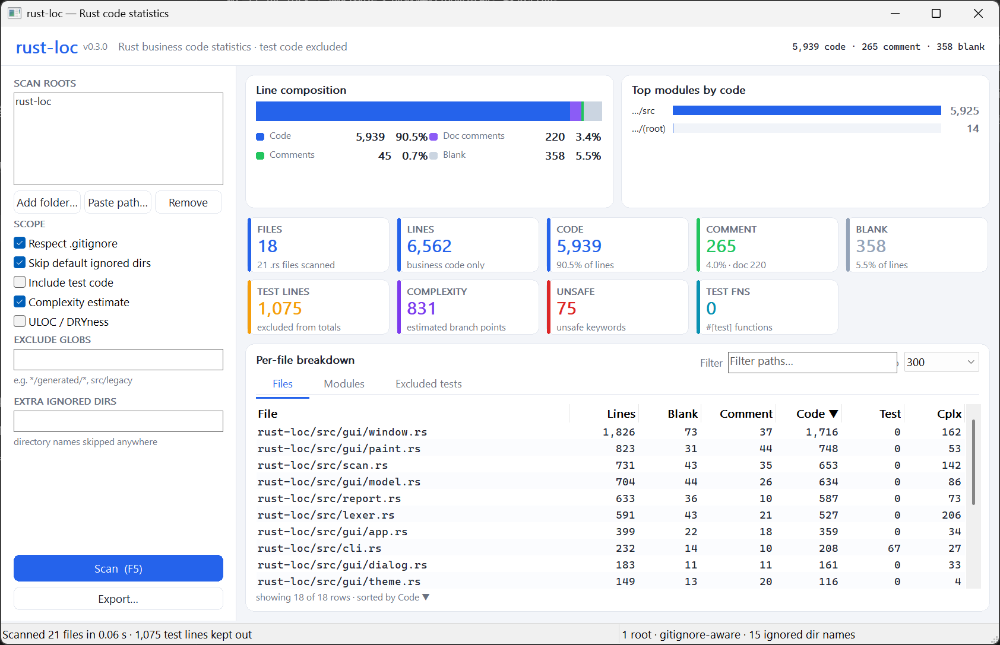
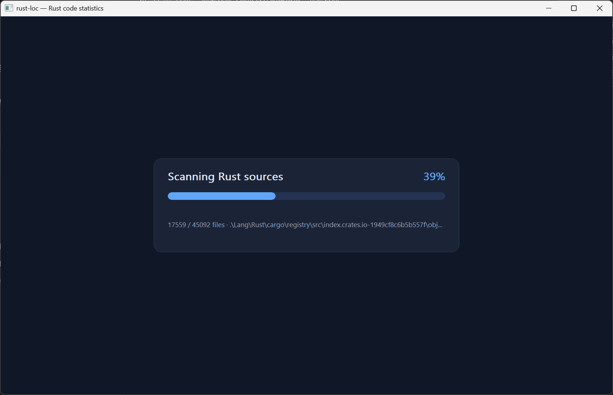

# rust-loc

Count Rust source lines — code, comments and blanks — **with test code excluded**, plus ULOC, an
scc-style complexity estimate, `unsafe` occurrences and test-function counts.

Rust only, zero runtime dependencies, single file of logic.

## Why another line counter

`tokei`, `scc`, `cloc` and `cargo-count` all answer "how big is this codebase?", but none of them can
answer "how big is the **shipped** codebase?". Rust projects keep a large share of their code behind
`#[cfg(test)]` and in `tests/`, and those lines inflate every naive metric. `rust-loc` reports
business code by default and lists the excluded test lines separately.

| Capability                                     | tokei | scc | cloc | cargo-count | rust-loc |
| ---------------------------------------------- | :---: | :-: | :--: | :---------: | :------: |
| code / comment / blank / lines                 |  yes  | yes | yes  |     yes     |   yes    |
| per-file breakdown                             |  yes  | yes | yes  |     no      |   yes    |
| per-module grouping                            |  no   | no  |  no  |     no      |   yes    |
| sort and top-N                                 |  yes  | yes |  no  |     no      |   yes    |
| output formats                                 | JSON  |JSON,CSV|JSON,CSV,MD|  text   |text,JSON,CSV,MD|
| `.gitignore` / glob excludes                   |  yes  | yes | vcs  |     yes     |   yes    |
| unique lines (ULOC) and DRYness                |  no   | yes |  no  |     no      |   yes    |
| complexity estimate                            |  no   | yes |  no  |     no      |   yes    |
| `unsafe` counter                               |  no   | no  |  no  |     yes     |   yes    |
| **excludes test code**                         |  no   | no  |  no  |     no      | **yes**  |

## Install

```powershell
# from this directory
pip install -e .

# or run without installing
python src/rust_loc/cli.py --help
$env:PYTHONPATH = "src"; python -m rust_loc --help
```

Python 3.9+ and no third-party runtime dependencies. The optional desktop UI additionally uses
`tkinter`, which ships with the official python.org Windows installers.

## Usage

```powershell
rust-loc                                   # scan the current directory
rust-loc src-tauri/src src-tauri/crates    # scan explicit roots
rust-loc --by-file --sort complexity --top 15
rust-loc --uloc --by-module
rust-loc --format markdown > LOC.md
rust-loc --format csv --by-file > loc.csv
rust-loc --format json | ConvertFrom-Json
rust-loc --show-excluded                   # list the test-only files
rust-loc --include-tests                   # count test code after all
rust-loc --ui                              # open the native desktop UI
rust-loc --ui src-tauri/src --uloc         # the UI honours the same switches
```

Example (a Tauri app with a workspace crate):

```
Rust business code (tests excluded)
Roots: src-tauri/src, src-tauri/crates
Scope: gitignore-aware, 15 ignored directory names

Files                          145
Lines                       48,015
  Blank                      3,615   7.5%
  Comment                    4,035   8.4%   (doc 2,481)
  Code                      40,365  84.1%

Rust metrics
  Complexity (est.)          4,631
  Unsafe                       169
  Test functions                 1
  ULOC                      24,652  51.3% of lines (DRYness)

Excluded test code
  Test-only files              10 file(s), 9,633 lines
  #[cfg(test)] items                       15,747 lines

All Rust lines              73,395
```

### Options

| Option                        | Meaning                                                                       |
| ----------------------------- | ----------------------------------------------------------------------------- |
| `roots...` / `--root DIR`     | directories to scan (default `.`); repeatable                                 |
| `--format text,json,csv,markdown` | output format (default `text`); `--json` is an alias for `--format json`  |
| `--by-file`, `--by-module`    | add a per-file / per-module table                                             |
| `--sort code,lines,blank,comment,test,complexity,unsafe,test_fns,uloc,path` | sort key, descending (default `code`) |
| `--top N`                     | limit listings to N rows                                                      |
| `--show-excluded`             | list test-only files and their sizes                                          |
| `--include-tests`             | count test code as code instead of excluding it                               |
| `--uloc`                      | compute ULOC and DRYness                                                      |
| `--no-complexity`             | hide the complexity estimate                                                  |
| `--exclude GLOB`              | skip matching paths, repeatable (fnmatch, matches relative or absolute path)   |
| `--ignore-dir NAME`           | skip directories with this name, repeatable                                   |
| `--no-ignore-dirs`            | do not skip the default directory names                                       |
| `--gitignore` / `--no-gitignore` | force / disable `.gitignore` filtering (default: on when git is available)  |
| `--ui`                      | open the native desktop UI (see below)                                        |
| `--version`                   | print the version                                                             |

Default ignored directory names: `.git`, `.hg`, `.svn`, `target`, `node_modules`, `.svelte-kit`,
`build`, `dist`, `vendor`, `.venv`, `venv`, `__pycache__`, `.mypy_cache`, `.pytest_cache`, `.tox`.

`.gitignore` filtering uses `git ls-files --cached --others --exclude-standard`, so tracked and
new-but-not-ignored files are counted while ignored ones are skipped. If `git` is missing or the
path is not a repository the filter silently degrades to the ignore-directory and glob rules.

## Desktop UI (native, no web stack)



```powershell
rust-loc --ui                                 # scan the current directory
rust-loc --ui src-tauri/src src-tauri/crates  # scan explicit roots
rust-loc --ui --uloc --include-tests          # the UI starts from the CLI switches
rust-loc-ui                                   # the same window as a GUI script
python -m rust_loc.ui                         # without installing
```

The window is built from the standard library alone (`tkinter` / `ttk`), so there is no HTTP
server, no HTML/CSS/JS, no Electron or Tauri and no extra dependency to install. It uses native
widgets and starts in well under a second. Measured on this machine: about 86 MB of working set for an
idle window (that is the CPython + Tcl/Tk baseline, fonts included) and 95 MB after scanning a
155-file, 48 kLOC tree, i.e. the scan itself costs under 10 MB.

* **Scan roots** — add folders, paste a list of paths (`;` separated), remove entries, double-click to
  open one in Explorer.
* **Scope switches** — `.gitignore`, the default ignored directories, `--include-tests`, complexity and
  ULOC; toggling one rescans immediately.
* **KPI cards** — files, lines, code, comment (with the doc share), blank, excluded test lines,
  complexity, unsafe, test functions and ULOC/DRYness.
* **Charts** — a stacked line-composition bar (code / doc comments / comments / blank) and the
  biggest modules by code, drawn on plain canvases.
* **Tables** — per-file, per-module and excluded-test tabs (click one, or cycle with `Ctrl+Tab`):
  click a heading to sort, filter by substring, cap the row count with Top, double-click a row to
  open the file.
* **Export** — the current result as text, Markdown, CSV or JSON, plus "Copy summary as Markdown"
  and "Copy equivalent CLI command" to reproduce the run in a terminal.

A scan that takes longer than a moment covers the window with a translucent mask, so the numbers
never look frozen while the tree is being read:



Under the hood:

* scanning runs on a worker thread and reports through a queue, so the window keeps painting on
  large trees;
* the mask appears only after ~0.2 s and tracks the file being read, so short scans never flash it;
* child processes (`git`, used to honour `.gitignore`) are spawned with `CREATE_NO_WINDOW`, so no
  console window ever pops up during a scan;
* the per-line arrays are dropped as soon as a file is summarised, and only the visible rows are
  inserted into the table, which keeps both memory and paint time low;
* roots, switches and filters are remembered in `%APPDATA%\rust-loc\ui.json`.

## What counts as test code

Removed from the business totals and reported separately:

- **test-only files** — anything under a `tests`/`benches` directory, plus `tests.rs`, `test.rs`,
  `*_tests.rs`, `*_test.rs`; files pulled in by a `#[cfg(test)] mod name;` declaration (including the
  one named by `#[path = "..."]`); and files carrying a crate-level `#![cfg(test)]`;
- **`#[cfg(test)]` and `#[cfg(all(test, ...))]` items** — the whole balanced item (attributes, body
  and closing brace) is excluded, with nested braces, strings, raw strings, char literals and nested
  block comments handled.

Kept in the business totals because they also compile into normal builds: `#[cfg(any(test, ...))]`
and `#[cfg(not(test))]`.

## Metric definitions

- **Lines** = blank + comment + code, i.e. physical lines with test code removed. `Test` and the
  test-only file totals are shown separately so nothing is hidden.
- **Comment** includes doc comments; **doc** is reported as a subset of comment lines.
- **ULOC** = number of distinct non-blank lines (`sort -u | wc -l`), as described in
  <https://cmcenroe.me/2018/12/14/uloc.html>. **DRYness** = ULOC / Lines.
- **Complexity (est.)** = file-level count of the same Rust branch tokens scc uses in its language
  config: `if`, `else`, `for`, `while`, `loop`, `match`, `&&`, `||`, `==`, `!=`.
- **Unsafe** = occurrences of the `unsafe` keyword.
- **Test functions** = attributes matching `#[test]`, `#[tokio::test]`, `#[async_std::test]`,
  `#[rstest]`, ... followed by a `fn`.

All extras (complexity, unsafe, test functions) are counted only outside excluded test code, so they
describe business code unless `--include-tests` is given.

## Accuracy and limitations

- Rust only, and lexer-based rather than AST-based: `cargo::include!`, procedural macros and code
  generated at build time are not expanded, so their contents are not attributed.
- Complexity is a deliberate approximation (see scc's own description); it is only comparable
  between files in the same language.
- Platform-gated code (`#[cfg(target_os = ...)]`) is counted regardless of host OS, since this is a
  static counter.
- A `#[cfg(test)]` item whose closing brace never appears (truncated file) is treated as running to
  the end of the file.

## Development

```powershell
python -m unittest discover -s tests -t .
pytest -q                       # optional; the suite is plain unittest
```

Layout:

```
src/rust_loc/cli.py         lexer, aggregation, reporting, CLI (scan/render helpers shared with the UI)
src/rust_loc/ui.py          native tkinter/ttk desktop window
src/rust_loc/ui_model.py    tkinter-free presentation helpers (rows, cards, charts, settings)
src/rust_loc/__main__.py
tests/test_cli.py           end-to-end CLI tests built on temporary fixtures
tests/test_ui_model.py      presentation helper tests (no window needed)
```

## License

Not chosen yet — add a `LICENSE` file before publishing.
